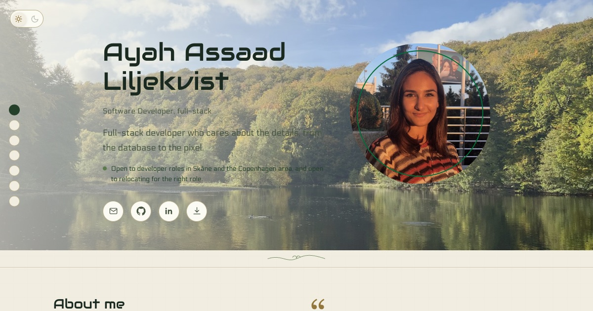

# Ayah Assaad Liljekvist · Portfolio

My personal portfolio: **[ayahs-portfolio.vercel.app](https://ayahs-portfolio.vercel.app/)**



Full-stack developer who cares about the details, from the database to the pixel.
Open to developer roles in Skåne and the Copenhagen area.

## Built with

Plain HTML, CSS and JavaScript. No framework and no component library: every
interaction on the page is written by hand.

- Light and dark theme that remembers your choice
- Dot navigation that follows your scroll position
- Project cards with stack, features and screenshots
- Recommendations carousel you can click, swipe or use with arrow keys
- Responsive from phone to desktop
- Still readable with JavaScript turned off
- Respects reduced motion and keyboard navigation

## Run it locally

There is no build step. Open `index.html` in a browser, or serve the folder:

```bash
python3 -m http.server 8000
```

Then visit http://localhost:8000.

## Structure

```text
index.html   page content and scripts
styles.css   all styles, with light and dark color tokens
assets/      photos, project screenshots, CV and recommendation letter
```

Deployed on Vercel from `main`.
